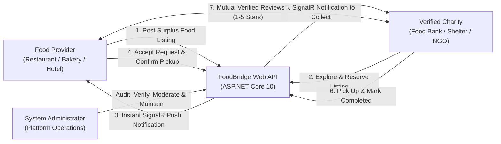

# 🥗 FoodBridge Platform — Food Surplus Management & Charity Redistribution System

[](https://dotnet.microsoft.com/)
[](https://learn.microsoft.com/en-us/dotnet/csharp/)
[](https://blog.cleancoder.com/uncle-bob/2012/08/13/the-clean-architecture.html)
[](https://learn.microsoft.com/en-us/ef/core/)
[](https://www.microsoft.com/sql-server/)
[](https://learn.microsoft.com/en-us/aspnet/core/signalr/)
[](https://tailwindcss.com/)
[](https://leafletjs.com/)
[](tests/FoodBridge.Tests)

> **Digital Egypt Pioneers Initiative (DEPI) Graduation Project — Enterprise Full-Stack .NET Solution**  
> Architected according to **Clean Architecture** principles, featuring ASP.NET Core 10 Web API, Entity Framework Core 10 with SQL Server, ASP.NET Core Identity with JWT Authentication, SignalR Real-Time Communications, Background Hosted Services, Interactive Geospatial Mapping, and a Fully Responsive Web UI across Mobile, Tablet, and Desktop.

---

## 📌 Table of Contents
1. [What is FoodBridge? (Mission & Problem Domain)](#-what-is-foodbridge)
2. [User Roles & Architectural Workflows](#-user-roles--architectural-workflows)
3. [Technology Stack](#-technology-stack)
4. [Clean Architecture Solution Structure](#-clean-architecture-solution-structure)
5. [Key Enterprise Features](#-key-enterprise-features)
6. [Interactive Egypt Coverage Map](#-interactive-egypt-coverage-map)
7. [Real-Time System Maintenance Mode](#-real-time-system-maintenance-mode)
8. [Full Responsive Design System](#-full-responsive-design-system)
9. [Domain Entities & Concurrency Control](#-domain-entities--concurrency-control)
10. [Pre-Seeded Demonstration Accounts](#-pre-seeded-demonstration-accounts)
11. [Getting Started & Automated Tests](#-getting-started--automated-tests)

---

## 🌍 What is FoodBridge?

**FoodBridge** is an enterprise-grade digital platform engineered to address two pressing humanitarian and environmental crises in Egypt: **massive food waste** and **food insecurity**.

### 🛑 The Problem in Egypt
* **Extreme Food Waste**: Restaurants, luxury hotels, bakeries, catering enterprises, and corporate events across Egyptian cities produce hundreds of tons of fresh, edible, high-quality surplus food daily that goes unconsumed and is discarded into landfills.
* **Environmental Impact**: Decomposing food surplus in landfills generates enormous volumes of methane gas, heavily accelerating greenhouse gas emissions and environmental degradation.
* **Charity Resource Gap**: Legitimate charitable foundations, food banks, refugee shelters, and orphanages struggle with logistical coordination, unpredictable food supply, and lack of real-time communication with potential food donors before perishable meals spoil.

### 💡 The Solution
FoodBridge bridges this gap by acting as a secure, real-time coordination ecosystem:
1. **Food Providers (Donors)** list available surplus meals, specify storage requirements, allergens, quantities, and pickup deadlines within seconds.
2. **Verified Charities (Recipients)** explore available donations regionally, reserve meals with a single click under strict concurrency safeguards, and coordinate collection.
3. **Platform Administrators** enforce regulatory oversight, verify official organization licenses, manage platform health via maintenance mode, and monitor full audit trails.

---

## 👥 User Roles & Architectural Workflows



### 1. Food Providers:
* Publish surplus food batches with high-resolution photos, meal categories, portion counts, allergen warnings, and strict pickup deadlines.
* Review incoming reservation requests with the ability to accept or decline with logged reasoning.
* Confirm exact pickup logistics and trigger live SignalR alerts when packages are packaged and ready for collection.
* Track cumulative philanthropic and environmental impact metrics (total kilograms of food rescued from landfills).

### 2. Charities & NGOs:
* Filter active surplus donations by food category, geographic region, and nearest expiry date.
* Submit instant reservation requests guarded by database-level optimistic concurrency (preventing double-booking).
* Receive real-time push alerts at every step: acceptance, pickup confirmation, and completion.
* Complete mutual partner evaluations and leave authenticated reviews.

### 3. System Administrators:
* Review pending provider and charity legal documentation; approve accounts or reject and suspend fraudulent entities with audit logging.
* Moderate public listings, partner reviews, and reported pickup disputes.
* Toggle the **Platform Maintenance Mode** in real time, automatically evicting active non-admin sessions via SignalR WebSockets.
* Inspect immutable audit log records tracking all administrative actions with timestamps and operator IDs.

---

## 🛠 Technology Stack

### 🖥️ Backend Core:
* **.NET 10 (C# 13)**: High-performance, modern runtime leveraging primary constructors, pattern matching, and performance optimizations.
* **ASP.NET Core Web API**: Clean RESTful architecture with structured JSON endpoints, attribute routing, and centralized error handling.
* **Entity Framework Core 10**: Object-Relational Mapper (ORM) with Fluent API configuration, strongly-typed domain relationships, and automated database migrations.
* **Microsoft SQL Server**: Enterprise relational database engine storing transactional data, audit logs, and identity credentials.
* **ASP.NET Core Identity & JWT Authentication**: Secure user management with HMAC-SHA256 encrypted JSON Web Tokens, claim-based authentication, and strict Role-Based Access Control (`Admin`, `Provider`, `Charity`).
* **SignalR Core**: Bi-directional, real-time WebSocket communication hub (`NotificationHub`) delivering instant push notifications and maintenance state synchronization.
* **Background Hosted Services**:
  * `ListingExpirationHostedService`: Periodic asynchronous background worker scanning and transitioning past-deadline listings from `Available` or `Reserved` to `Expired`.
  * `PickupReminderHostedService`: Background worker dispatching proactive reminder notifications 2 hours prior to scheduled pickup deadlines.
* **Optimistic Concurrency Control**: Configured `byte[] RowVersion` timestamp concurrency tokens on `FoodListing` and `Reservation` to eliminate race conditions.

### 🎨 Frontend & User Interface:
* **Clean Code Modular Architecture**: Engineered as 12 decoupled, single-responsibility ES6 modules:
  * `config.js`: Application endpoints, roles, and state storage keys.
  * `i18n.js`: Dynamic client-side bilingual translation dictionary (English & Arabic).
  * `theme.js`: Dark Mode / Light Mode theme engine with dynamic map tile synchronization.
  * `animations.js`: IntersectionObserver scroll-reveal animations with reduced-motion support.
  * `ui.js`: View router, toast notifications, navigation controllers, and responsive drawer toggles.
  * `auth.js`: JWT token lifecycle management, authentication modals, and role inspection.
  * `signalr-client.js`: SignalR client connection manager, live notification badge, and audio chime.
  * `maintenance.js`: Polling and live WebSocket maintenance listener with automatic session eviction.
  * `map.js`: Leaflet.js interactive Egypt geospatial coverage map with dynamic Dark/Light tiles.
  * `portals/explore.js`: Donation search engine, category pills, and reservation modal logic.
  * `portals/provider.js`: Provider inventory management, listing creation, and request coordination.
  * `portals/charity.js`: Charity reservation tracker, pickup coordination, and mutual reviews.
  * `portals/admin.js`: Administrative portal, verification approvals/rejections, waste logs, and audit trails.
  * `portals/impact.js`: Real-time impact metrics and Chart.js environmental analytics.
* **Tailwind CSS 3.4**: Utility-first CSS framework with customized color palettes, glassmorphism backdrops, and multi-breakpoint responsive utilities.
* **Leaflet.js 1.9**: Interactive mapping library rendering regional distribution hubs across Egypt with animated markers and fly-to focus transitions.
* **Chart.js**: Dynamic data visualizations showcasing redistributed food weights, meal portions, and category distributions.
* **FontAwesome 6 Pro**: Iconography delivering an intuitive, polished visual hierarchy.

---

## 🏛 Clean Architecture Solution Structure

The project strictly follows Uncle Bob's Clean Architecture pattern, decoupling business rules from UI, database, and third-party frameworks:

```
FoodBridge/
├── src/
│   ├── FoodBridge.Domain/          # Core Enterprise Business Rules & Entities
│   │   ├── Entities/               # ApplicationUser, FoodListing, Reservation, Review, Notification, AuditLog
│   │   └── Enums/                  # UserType, UserStatus, FoodCategory, FoodListingStatus, ReservationStatus
│   │
│   ├── FoodBridge.Application/     # Application Business Rules, Use Cases & Interfaces
│   │   ├── Common/                 # Result<T> pattern, IApplicationDbContext, INotificationService
│   │   ├── DTOs/                   # Request & Response Data Transfer Objects
│   │   └── Services/               # Domain service implementations: AuthService, FoodListingService,
│   │                               # ReservationService, ReviewService, AdminService, ReportingService
│   │
│   ├── FoodBridge.Infrastructure/  # Frameworks, Persistence, Identity & External Services
│   │   ├── Data/                   # FoodBridgeDbContext, Fluent API entity mappings, DbInitializer
│   │   ├── Services/               # JwtTokenGenerator, LocalFileStorage, EmailSender, NotificationService
│   │   ├── Hubs/                   # SignalR NotificationHub (/hubs/notifications)
│   │   └── BackgroundServices/     # ListingExpirationHostedService, PickupReminderHostedService
│   │
│   └── FoodBridge.Web/             # Presentation Layer: Controllers & Web UI
│       ├── Controllers/            # Auth, FoodListings, Reservations, Reviews, Notifications, Admin, Reports
│       ├── Services/               # CurrentUserService (IHttpContextAccessor wrapper)
│       └── wwwroot/                # Modular SPA Frontend (HTML5, Tailwind CSS, Modular JS)
│
└── tests/
    └── FoodBridge.Tests/           # Unit & Integration Tests (xUnit, Moq, EF Core InMemory)
```

---

## 🌟 Key Enterprise Features

### 1. Real-Time Mutual Review System:
* Charities review Providers and Providers review Charities strictly upon reservation completion.
* Database unique index on `(ReservationId, ReviewerId)` mathematically guarantees **1 review per party per completed reservation**, preventing review bombing or fraudulent ratings.

### 2. Automated Donation Life-Cycle & Self-Healing:
* If a charity cancels an accepted reservation prior to the pickup deadline, the food listing status automatically reverts to `Available`, allowing other nearby charities to rescue the food before it spoils.

### 3. Strict Verification & Audit Compliance:
* Food providers and charities must undergo administrative verification before publishing listings or submitting reservation requests.
* Administrative rejections automatically transition the user account to `Suspended` and record an immutable entry into the `AuditLog` table with the exact reason and operator identity.

### 4. Calculated Platform Impact Metrics:
* Platform-wide rescued food metrics (kg of food redistributed, meal equivalents, carbon offset) are computed exclusively from **completed donations**, strictly filtering out cancelled, rejected, or expired listings.

---

## 🗺 Interactive Egypt Coverage Map

The landing page features a dedicated interactive geospatial module built with **Leaflet.js** highlighting FoodBridge's operational coverage across 7 strategic hubs in Egypt:

| Operational Hub | Geographic Scope | Hub Focus |
| :--- | :--- | :--- |
| **Greater Cairo & Giza Hub** | Cairo, Giza, 6th of October, New Cairo | High-density hotel and restaurant surplus redistribution |
| **Alexandria & North Coast Hub** | Alexandria, Borg El Arab, Northern Coast | Coastal restaurants, resorts, and local food banks |
| **Nile Delta Agricultural Hub** | Tanta, Mansoura, Zagazig, Menoufia | Bakeries, food producers, and rural charity networks |
| **Suez Canal Strategic Hub** | Port Said, Ismailia, Suez | Port facilities, catering services, and community shelters |
| **North & Central Upper Egypt** | Beni Suef, Minya, Asyut | Community kitchens and agricultural surplus relief |
| **Red Sea Resorts Hub** | Hurghada, El Gouna, Sharm El-Sheikh | Large-scale hospitality surplus coordination |
| **South Upper Egypt Hub** | Luxor, Aswan, Qena | Tourism hospitality partners and remote family assistance |

* **Interactive Features**: Clicking any hub card triggers an animated camera transition (`map.flyTo`) directly to the selected hub with a custom animated pin and popup.
* **Theme-Aware Tiles**: Automatically swaps between **Alidade Smooth** (Light Mode) and **Dark Matter** (Dark Mode) map tiles based on the active user theme.
* **Regional Filter Pills**: One-click filtering between Greater Cairo, Alexandria, Delta, Canal, and Upper Egypt.

---

## 🔒 Real-Time System Maintenance Mode

FoodBridge includes an enterprise maintenance mode for planned system updates, database migrations, and operational maintenance:

* **Live WebSocket Broadcast**: When an administrator activates maintenance mode, SignalR pushes an instant notification to all connected clients.
* **Automatic Session Eviction**: Active sessions for Providers and Charities are immediately terminated and redirected to the branded Maintenance Screen without requiring a page refresh.
* **Guarded Authentication**: Non-administrative sign-in attempts are rejected with localized messages informing users of ongoing system upgrades.
* **Admin Bypass & Banner**: Administrators retain full access to test, verify, and monitor the platform, complete with a persistent top banner indicating active maintenance status.
* **Instant Platform Unlock**: Once maintenance is deactivated, the platform unlocks instantly for all users.

---

## 📱 Full Responsive Design System

The application delivers a tailored user experience optimized for every viewport size:

| Device Category | Breakpoint | Responsive Features |
| :--- | :--- | :--- |
| **Mobile Phones** | `< 640px` | • **Slide-Down Mobile Drawer Menu**: Accessible via the header hamburger button (`#btnMobileMenu`).<br>• **Fixed Bottom Navigation Bar**: Touch-friendly navigation bar (`#bnav`) providing instant one-tap access to **Home, Browse, Map, Impact, and My Portal**.<br>• **Adaptive Layout Hierarchy**: Egypt Map displays first with optimal touch height (`min-h-[340px]`), followed by regional hub cards and KPI metrics in a 2-column grid.<br>• **Safe Area Padding**: `pb-14 md:pb-0` applied to prevent bottom navigation occlusion. |
| **Tablets** | `640px - 1024px` | • 2-column responsive card grids for listings and verification requests.<br>• Data tables enhanced with smooth custom horizontal scrollbars (`overflow-x-auto`).<br>• Centered modals with balanced padding. |
| **Desktops & Laptops** | `> 1024px` | • Full horizontal navigation header with live notification badge.<br>• 12-column grid combining the interactive map alongside regional hub cards.<br>• Expanded 4-column KPI overview statistics. |

---

## 🗄 Domain Entities & Concurrency Control

| Entity | Primary Key | Key Columns & Audit Fields | Relationships |
| :--- | :--- | :--- | :--- |
| **`ApplicationUser`** | `string Id` (Identity) | `FullName`, `OrganizationName`, `OrganizationAddress`, `UserType` (Provider/Charity/Admin), `SpecificType`, `IsVerified`, `Status` (Active/Suspended), `CreatedAt` | 1-to-N with `FoodListing`, `Reservation`, `Review`, `Notification`, `AuditLog` |
| **`FoodListing`** | `int Id` | `FoodName`, `Description`, `FoodCategory`, `Quantity`, `UnitOfMeasurement`, `PreparationDate`, `PickupDeadline`, `StorageConditions`, `Allergens`, `ImageUrl`, `Status`, `RowVersion` (Timestamp) | N-to-1 with Provider (`ApplicationUser`), 1-to-N with `Reservation` |
| **`Reservation`** | `int Id` | `FoodListingId`, `CharityId`, `RequestDate`, `PickupDateTime`, `ConfirmedLocation`, `Status`, `CancellationReason`, `ProblemDescription`, `CompletedAt`, `RowVersion` (Timestamp) | N-to-1 with `FoodListing`, N-to-1 with Charity (`ApplicationUser`), 1-to-N with `Review` |
| **`Review`** | `int Id` | `ReservationId`, `ReviewerId`, `RevieweeId`, `Rating` (1-5), `Comment`, `IsReported`, `ReportReason`, `CreatedAt` | Unique composite index on `(ReservationId, ReviewerId)` |
| **`Notification`** | `int Id` | `UserId`, `Title`, `Message`, `IsRead`, `RelatedEntityId`, `CreatedAt` | N-to-1 with `ApplicationUser`, indexed on `(UserId, IsRead)` |
| **`AuditLog`** | `int Id` | `AdminId`, `Action`, `TargetEntity`, `TargetId`, `Details`, `Timestamp` | N-to-1 with Admin (`ApplicationUser`), indexed on `Timestamp` |

---

## 🔑 Pre-Seeded Demonstration Accounts

The database automatically initializes with ready-to-use demonstration accounts covering every user persona:

| Role | Email | Password | Organization & Workflow Details |
| :--- | :--- | :--- | :--- |
| **Platform Administrator** | `admin@foodbridge.com` | `Admin@123456` | Platform Operations (Full Admin Dashboard, Moderation & Maintenance Control) |
| **Food Provider** | `chef.mario@bellaitalia.com` | `Provider@123` | Bella Italia Ristorante (Verified active Italian restaurant) |
| **Food Provider** | `sarah@lebreadcraft.com` | `Provider@123` | Artisan Bread & Pastry Co. (Verified active bakery) |
| **Food Provider (Pending)** | `banquets@grandpalace.com` | `Provider@123` | Grand Palace Hotel (Unverified — test Admin approval / rejection workflow) |
| **Charity Partner** | `coordinator@hopefoodbank.org` | `Charity@123` | Hope Community Food Bank (Verified active food bank) |
| **Charity Partner** | `shelter@stjude-care.org` | `Charity@123` | St. Jude Family Shelter (Verified active community shelter) |
| **Charity Partner (Pending)** | `youth@alnoor-foundation.org` | `Charity@123` | Al-Noor Refugee Relief (Unverified — test Admin approval / rejection workflow) |

---

## 🚀 Getting Started & Automated Tests

### Prerequisites:
* [.NET 10 SDK](https://dotnet.microsoft.com/download/dotnet/10.0) installed.
* [Microsoft SQL Server](https://www.microsoft.com/sql-server/) (or SQL Server LocalDB).

### 1. Run Automated Tests:
The test suite consists of **17 comprehensive unit and integration tests** verifying optimistic concurrency, background expiration sweeps, mutual review constraints, administrative audit logging, and metric calculations:

```powershell
cd FoodBridge
dotnet test
```

**Expected Result:**
```text
Passed!  - Failed: 0, Passed: 17, Skipped: 0, Total: 17, Duration: 800 ms - FoodBridge.Tests.dll
```

### 2. Run the Full-Stack Application:
Launch the application with database auto-creation and seeding:

```powershell
cd FoodBridge
dotnet run --project src/FoodBridge.Web/FoodBridge.Web.csproj --urls "http://localhost:5000"
```

Open your browser and navigate to:
```
http://localhost:5000
```

---

## 📄 License & Attribution
Developed as a Graduation Capstone Project for the **Digital Egypt Pioneers Initiative (DEPI)**.  
All rights reserved © 2026 **FoodBridge Platform**.
