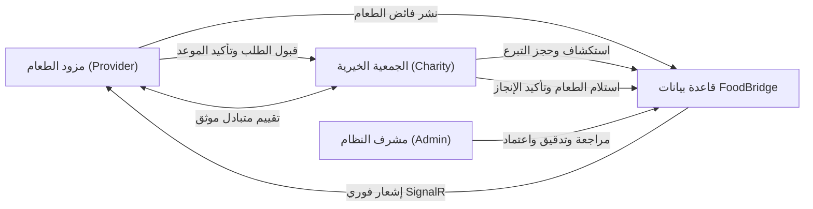

# 🥗 FoodBridge Platform — المنظومة الذكية لإدارة وإعادة توزيع فائض الطعام في مصر

> **مشروع تخرج مبادرة مصر الرقمية (DEPI Graduation Project) — حل برمجي سحابي متكامل للمؤسسات (Enterprise Full-Stack .NET Solution)**  
> مبني وفق أعلى معايير هندسة البرمجيات وبنية **Clean Architecture** المعتمدة من مايكروسوفت، مع واجهة مستخدم متجاوبة بالكامل لجميع أحجام الشاشات (Mobile, Tablet, Desktop)، وخريطة تفاعلية لتغطية محافظات مصر، وإشعارات لحظية عبر SignalR، ونظام صيانة لحظي، وتوافق تام بين اللغتين العربية والإنجليزية.

---

## 📌 جدول المحتويات (Table of Contents)
1. [ماهو نظام FoodBridge؟ (System Overview & Mission)](#-ماهو-نظام-foodbridge)
2. [رحلة المستخدم والأدوار (User Roles & Workflows)](#-رحلة-المستخدم-والأدوار)
3. [جميع التقنيات المستخدمة (Technology Stack)](#-جميع-التقنيات-المستخدمة)
4. [الهيكلية البرمجية (Clean Architecture Structure)](#-الهيكلية-البرمجية-clean-architecture)
5. [الميزات المتقدمة المنفذة حديثاً (Key Advanced Features)](#-الميزات-المتقدمة-المنفذة-حديثا)
6. [التجاوب الكامل مع الشاشات (Full Responsive Design)](#-التجاوب-الكامل-مع-الشاشات)
7. [الكيانات وقواعد البيانات (Entities & Database Schema)](#-الكيانات-وقواعد-البيانات)
8. [الحسابات التجريبية الجاهزة (Demo Accounts)](#-الحسابات-التجريبية-الجاهزة)
9. [دليل التشغيل والاختبارات (Getting Started & Tests)](#-دليل-التشغيل-والاختبارات)

---

## 🌍 ماهو نظام FoodBridge؟

**FoodBridge (جسر الغذاء)** هي منصة تقنية مصرية تهدف إلى حل واحدة من أكبر المشاكل الإنسانية والبيئية والاقتصادية: **هدر الطعام وسد فجوة الجوع**.

### 🛑 المشكلة في مصر:
* تهدر المطاعم، الفنادق، المخابز، وشركات التموين والضيافة يومياً آلاف الأطنان من الأطعمة والوجبات الصالحة تماماً للاستهلاك الآدمي.
* في الوقت نفسه، تبذل الجمعيات الخيرية وبنوك الطعام ودور الرعاية جهوداً مضنية لتوفير وجبات للأسر المستحقة، وتواجه صعوبة في تنسيق التبرعات العينية وتتبعها في الوقت المناسب قبل تلفها.
* يسبب التخلص التقليدي من الطعام في مكبات النفايات انبعاثات ضخمة لغاز الميثان المضر بالبيئة ويزيد من البصمة الكربونية.

### 💡 الحل الذي تقدمه المنصة:
تعمل **FoodBridge** كحلقة وصل تقنية فورية وآمنة بين:
1. **مزودي الطعام (Food Providers):** عرض وجباتهم وفائضهم اليومي بكل دقة (الكمية، وقت الاستلام، شروط الحفظ، مسببات الحساسية، والصور).
2. **الجمعيات والمؤسسات الأهلية (Charities & NGOs):** استكشاف التبرعات المتاحة جغرافياً وحجزها بضغطة زر واحدة لمنع تلفها.
3. **إدارة المنصة (Platform Administration):** التحقق الصارم من الهويات القانونية، مراقبة الجودة، متابعة أثر إعادة التوزيع، وتأمين النظام.

---

## 👥 رحلة المستخدم والأدوار



### 1. مزودو الطعام (Food Providers):
* إضافة عروض التبرع ببيانات تفصيلية وصور وروابط مسببات الحساسية وشروط التبريد.
* إدارة طلبات الحجز الواردة من الجمعيات (قبول / رفض مع ذكر السبب).
* تحديد موعد الاستلام وتنبيه الجمعية فور تجهيز وتغليف الشحنة.
* الاطلاع على سجل العمليات وإحصائيات الأثر البيئي (كيلوجرامات الطعام المعاد توجيهها).

### 2. الجمعيات والمؤسسات الخيرية (Charities):
* تصفح عروض التبرع الحية مع الفلترة حسب التصنيف، المسافة، وتاريخ الصلاحية.
* طلب حجز الوجبات بضغطة زر واحدة (محمية بآلية منع التكرار المتزامن).
* استلام الإشعارات اللحظية فور قبول المزود أو تجهيز الوجبات للاستلام.
* تقييم جودة الوجبات ودقة المزود وتوثيق توزيعها على المستفيدين.

### 3. مشرفو النظام (System Administrators):
* اعتماد الجمعيات والمزودين بعد فحص السجلات الرسمية أو رفض الحسابات وتجميدها.
* إدارة المحتوى والإشراف على التقييمات والبلاغات ومشاكل الاستلام.
* تفعيل **وضع الصيانة اللحظي (Maintenance Mode)** وإخراج المستخدمين تلقائياً.
* سجل تدقيق رقمي متكامل (Audit Logs) لجميع الإجراءات الإدارية.

---

## 🛠 جميع التقنيات المستخدمة

تم بناء النظام بالكامل وفق أحدث معايير هندسة البرمجيات المؤسسية:

### 🖥️ الباك إند (Backend):
* **.NET 10 (C# 13):** أحدث إصدار من بيئة عمل مايكروسوفت مع أداء فائق وسرعة معالجة عالية.
* **ASP.NET Core Web API:** بنية RESTful API منظمة مع تشفير وحماية كاملة.
* **Entity Framework Core 10:** لإدارة التعامل مع قاعدة البيانات، مع دعم العمليات المعقدة والـ Migrations التلقائية.
* **Microsoft SQL Server:** قاعدة البيانات العلاقية الأساسية لحفظ البيانات والبيانات المحاسبية والتدقيقية.
* **ASP.NET Core Identity & JWT:** إدارة المستخدمين وتوليد توكنات الأمان المشفرة (HMAC-SHA256) مع صلاحيات مبنية على الأدوار (Role-Based Authorization).
* **SignalR Core:** اتصالات WebSocket لحظية ثنائية الاتجاه لنظام الإشعارات المباشرة وتزامن الصيانة.
* **Background Hosted Services:**
  * `ListingExpirationHostedService`: خدمة خلفية دورية تفحص تلقائياً تبرعات الطعام وتحول المنتهية منها إلى حالة `Expired`.
  * `PickupReminderHostedService`: خدمة خلفية ترسل تنبيهات تذكيرية قبل موعد الاستلام بساعتين للطرفين.
* **Optimistic Concurrency Control:** حماية التزامن المتفائل باستخدام `RowVersion` لمنع حجز نفس الوجبة من أكثر من جمعية في نفس الجزء من الثانية.

### 🎨 الفرونت إند وتجربة المستخدم (Frontend & UI):
* **Modular Clean Architecture JS:** تم تفكيك الكود البرمجي من ملف أحادي ضخم إلى 12 وحدة برمجية منفصلة تتبع معايير Clean Code و Single Responsibility Principle:
  * `config.js`: المتغيرات العامة ونقاط النهاية.
  * `i18n.js`: قاموس الترجمة الفورية وثنائية اللغة (عربي / إنجليزي).
  * `theme.js`: إدارة الوضع الليلي والنهاري.
  * `animations.js`: التحكم في انيميشن الظهور السلس وتأثيرات البطاقات.
  * `ui.js`: التوجيه بين الصفحات، القوائم المتجاوبة، وعرض الـ Toasts.
  * `auth.js`: جلسات الدخول والتوكنات والتحقق من الأدوار.
  * `signalr-client.js`: الربط اللحظي واستقبال التنبيهات.
  * `maintenance.js`: فحص حالة الصيانة والطرد التلقائي للمستخدمين.
  * `map.js`: تشغيل وإدارة خريطة محافظات مصر التفاعلية.
  * `portals/explore.js`: تصفح التبرعات والفلترة والبحث المتقدم.
  * `portals/provider.js`: لوحة تحكم المزودين وإدارة التبرعات.
  * `portals/charity.js`: لوحة تحكم الجمعيات ومتابعة الحجوزات.
  * `portals/admin.js`: لوحة المشرف، الاعتمادات، وحفظ العمليات.
  * `portals/impact.js`: إحصائيات الأثر وحساب النعمة والرسوم البيانية.
* **Tailwind CSS:** تصميم حديث وجذاب مع دعم كامل للـ Responsive Breakpoints والتنسيق المخصص.
* **Leaflet.js:** خريطة جغرافية تفاعلية لمصر تدعم الوضعين الليلي والنهاري والمواقع التفاعلية.
* **Chart.js:** رسوم بيانية ديناميكية لعرض كميات الطعام الموزعة وتوزيع الفئات.
* **FontAwesome 6 Pro Icons:** أيقونات حديثة تمنح التطبيق طابعاً عصرياً.

---

## 🏛 الهيكلية البرمجية (Clean Architecture)

تم تقسيم المشروع إلى 4 طبقات رئيسية منفصلة وفق Clean Architecture:

```
FoodBridge/
├── src/
│   ├── FoodBridge.Domain/          # الطبقة المركزية: الكيانات الأساسية، Enums، وقواعد الأعمال
│   │   ├── Entities/               # ApplicationUser, FoodListing, Reservation, Review, Notification, AuditLog
│   │   └── Enums/                  # UserType, UserStatus, FoodCategory, FoodListingStatus, ReservationStatus
│   │
│   ├── FoodBridge.Application/     # طبقة التطبيق: حالات الاستخدام (Use Cases)، واجهات الخدمات، ونماذج DTOs
│   │   ├── Common/                 # Result<T> pattern, IApplicationDbContext, Interfaces
│   │   ├── DTOs/                   # Data Transfer Objects لنقل البيانات بأمان
│   │   └── Services/               # منطق الأعمال: AuthService, FoodListingService, ReservationService, AdminService...
│   │
│   ├── FoodBridge.Infrastructure/  # طبقة البنية التحتية: الاتصال بقاعدة البيانات، Identity، والخدمات الخارجية
│   │   ├── Data/                   # FoodBridgeDbContext, Fluent API Mappings, DbInitializer
│   │   ├── Services/               # JwtTokenGenerator, LocalFileStorage, EmailSender, NotificationService
│   │   ├── Hubs/                   # SignalR NotificationHub (/hubs/notifications)
│   │   └── BackgroundServices/     # ListingExpirationHostedService, PickupReminderHostedService
│   │
│   └── FoodBridge.Web/             # طبقة العرض والواجهة: REST API Controllers وواجهة الويب المتجاوبة
│       ├── Controllers/            # Auth, FoodListings, Reservations, Reviews, Notifications, Admin, Reports
│       └── wwwroot/                # أصول الفرونت إند (HTML, CSS, Modular JS)
│
└── tests/
    └── FoodBridge.Tests/           # اختبارات الوحدة والتكامل (xUnit, Moq, EF InMemory)
```

---

## 🌟 الميزات المتقدمة المنفذة حديثاً

### 1. خريطة تغطية محافظات مصر التفاعلية (Egypt Coverage Map):
* تغطية 7 مراكز ومحطات توزيع إقليمية (القاهرة والجيزة، الإسكندرية والساحل، الدلتا، مدن القناة، شمال ووسط الصعيد، البحر الأحمر والمنتجعات، وجنوب الصعيد والأقصر وأسوان).
* بطاقات تفاعلية تتيح الانتقال الفوري بالخريطة (`flyTo`) مع أنيميشن سلس ومؤشرات ملونة وفق حجم النشاط.
* إمكانية الفلترة حسب الإقليم الجغرافي، مع تبديل تلقائي لخرائط Alidade Smooth في الوضع النهاري و Dark Matter في الوضع الليلي.

### 2. نظام وضع الصيانة اللحظي مع الإخلاء الفوري (Maintenance Mode):
* إمكانية قيام المشرف بتفعيل الصيانة وتحديد موعد العودة المتوقع وسبب الصيانة باللغتين.
* **طرد لحظي للمستخدمين النشطين:** فور تفعيل الصيانة، يبث الـ SignalR Hub إشعاراً فورياً يغلق جلسات جميع المزودين والجمعيات ويوجههم إلى صفحة الصيانة دون الحاجة لإعادة تحميل الصفحة.
* منع أي مستخدم غير المشرف من تسجيل الدخول أثناء الصيانة برسالة واضحة بلغة الموقع المحددة.
* شريط تنبيهي خاص بالمشرف يسمح له بالتصفح وإدارة المنصة أثناء الصيانة وفك الحظر بضغطة زر.

### 3. تدقيق واعتماد المنظمات ومسار الرفض (Admin Moderation & Rejection):
* عرض طلبات اعتماد الجمعيات والمزودين غير الموثقين.
* إمكانية القبول وتفعيل الحساب فوراً، أو الرفض مع تجميد الحساب وتوثيق الإجراء الإداري في الـ Audit Log.
* تصفية تلقائية للطلبات المعلقة في الإحصائيات بحيث تُستبعد الحسابات المجمدة.

---

## 📱 التجاوب الكامل مع الشاشات (Full Responsive Design)

تم تصميم واجهات FoodBridge لتقديم تجربة استخدام مثالية على مختلف أنواع الأجهزة:

| نوع الجهاز | مقاس الشاشة | الميزات والتكيف البرمجي |
| :--- | :--- | :--- |
| **الهواتف الذكية (Mobile)** | `< 640px` | • قائمة جانبية منسدلة (Slide-down Drawer) عبر زر الهامبرغر.<br>• شريط تنقل سفلي ثابت (Bottom Navigation Bar) للوصول بلمسة واحدة للرئيسية، الاستكشاف، الخريطة، الأثر، والبوابة.<br>• ترتيب عمودي ذكي: عرض الخريطة أولاً ثم البطاقات الإقليمية أسفلها.<br>• حماية المساحة السفلية مع Safe-Area Padding لمنع تداخل الأزرار. |
| **الأجهزة اللوحية (Tablet)** | `640px - 1024px` | • شبكة شبيهة بـ Grid ثنائية الأعمدة للبطاقات والتبرعات.<br>• جداول بيانات مع شريط تمرير أفقي مخصص فائق السلاسة.<br>• إحصائيات متجاوبة تعرض في شبكة 2×2. |
| **الشاشات الكبيرة (Desktop)** | `> 1024px` | • شريط تنقل علوي كامل مع القوائم والمؤشرات اللحظية.<br>• عرض الخريطة والبطاقات جنباً إلى جنب في شبكة 12 عموداً.<br>• تجربة مريحة لإدارة البيانات واللوحات المتقدمة للمشرف والمزودين. |

---

## 🗄 الكيانات وقواعد البيانات (Entities & Database Schema)

| الكيان (Entity) | المفتاح الأساسي | الحقول الرئيسية والأعمدة التدقيقية | العلاقات (Relationships) |
| :--- | :--- | :--- | :--- |
| **`ApplicationUser`** | `string Id` | `FullName`, `OrganizationName`, `OrganizationAddress`, `UserType`, `SpecificType`, `IsVerified`, `Status` (Active/Suspended), `CreatedAt` | 1 إلى N مع التبرعات، الحجوزات، التقييمات، والإشعارات |
| **`FoodListing`** | `int Id` | `FoodName`, `FoodCategory`, `Quantity`, `UnitOfMeasurement`, `PickupDeadline`, `StorageConditions`, `Allergens`, `Status`, `RowVersion` | N إلى 1 مع المزود، 1 إلى N مع الحجوزات |
| **`Reservation`** | `int Id` | `FoodListingId`, `CharityId`, `RequestDate`, `PickupDateTime`, `ConfirmedLocation`, `Status`, `RowVersion` | N إلى 1 مع التبرع، N إلى 1 مع الجمعية، 1 إلى N مع التقييمات |
| **`Review`** | `int Id` | `ReservationId`, `ReviewerId`, `RevieweeId`, `Rating` (1-5), `Comment`, `CreatedAt` | فهرس فريد يمنع تكرار التقييم لنفس الحجز |
| **`AuditLog`** | `int Id` | `AdminId`, `Action`, `TargetEntity`, `TargetId`, `Details`, `Timestamp` | توثيق غير قابل للحذف لجميع قرارات المشرفين |
| **`Notification`** | `int Id` | `UserId`, `Title`, `Message`, `IsRead`, `RelatedEntityId`, `CreatedAt` | N إلى 1 مع المستخدم |

---

## 🔑 الحسابات التجريبية الجاهزة (Demo Accounts)

تم تجهيز قاعدة البيانات بحسابات تجريبية مسبقة تغطي كافة السيناريوهات:

| الدور (Role) | البريد الإلكتروني | كلمة المرور | المنظمة / الوصف |
| :--- | :--- | :--- | :--- |
| **مشرف النظام (Admin)** | `admin@foodbridge.com` | `Admin@123456` | إدارة النظام بالكامل، التدقيق، واعتماد الحسابات والصيانة |
| **مزود طعام (Provider)** | `chef.mario@bellaitalia.com` | `Provider@123` | مطعم بيلا إيطاليا (مزود معتمد ونشط) |
| **مزود طعام (Provider)** | `sarah@lebreadcraft.com` | `Provider@123` | مخبز الحرفيين (مزود معتمد ونشط) |
| **مزود غير معتمد (Pending)** | `banquets@grandpalace.com` | `Provider@123` | فندق جراند بالاس (حساب بانتظار موافقة أو رفض المشرف) |
| **جمعية خيرية (Charity)** | `coordinator@hopefoodbank.org` | `Charity@123` | بنك طعام الأمل (جمعية معتمدة لحجز واستلام التبرعات) |
| **جمعية خيرية (Charity)** | `shelter@stjude-care.org` | `Charity@123` | دار رعاية سانت جود (جمعية معتمدة) |
| **جمعية غير معتمدة (Pending)**| `youth@alnoor-foundation.org` | `Charity@123` | مؤسسة النور للإغاثة (حساب بانتظار فحص المشرف) |

---

## 🚀 دليل التشغيل والاختبارات (Getting Started & Tests)

### المتطلبات المسبقة:
* مثبت [.NET 10 SDK](https://dotnet.microsoft.com/download/dotnet/10.0)
* قاعدة بيانات [Microsoft SQL Server](https://www.microsoft.com/sql-server/) (أو LocalDB)

### 1. تشغيل الاختبارات الآلية (Automated Tests):
يحتوي المشروع على **17 اختبار وحدة وتكامل** شاملة:
```powershell
cd FoodBridge
dotnet test
```
> النتيجة المتوقعة: **Passed! - Failed: 0, Passed: 17, Skipped: 0**

### 2. تشغيل المشروع (Full-Stack Run):
```powershell
cd FoodBridge
dotnet run --project src/FoodBridge.Web/FoodBridge.Web.csproj --urls "http://localhost:5000"
```
افتح المتصفح وتوجه إلى: `http://localhost:5000`

---

## 📄 الترخيص وحقوق الملكية
تم تطوير هذا المشروع كجزء من متطلبات التخرج من **مبادرة مصر الرقمية (Digital Egypt Pioneers Initiative - DEPI)**.  
جميع الحقوق محفوظة © 2026 **FoodBridge Platform**.
